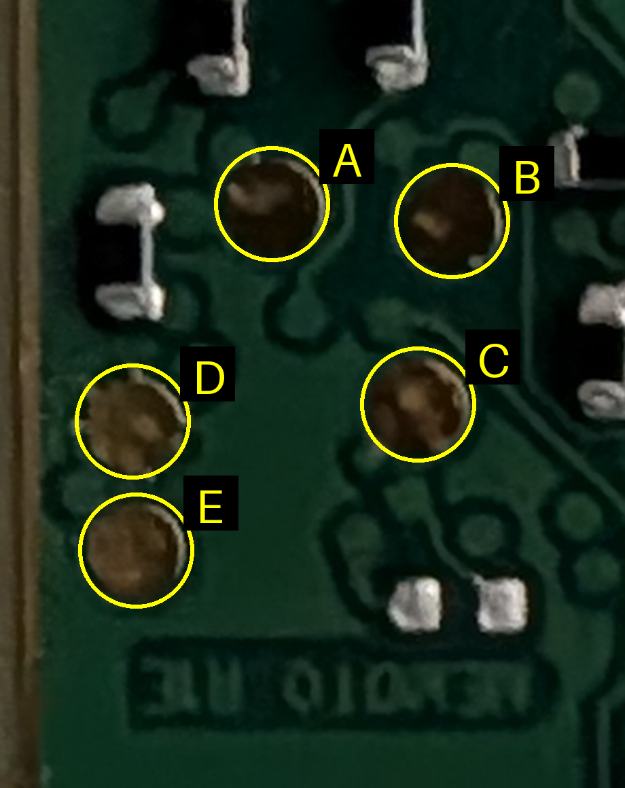

<p align="center"></p>

# magpie

Open firmware for the Narrative Clip 1, the small wearable lifelogging camera from 2013 (Atmel AT91SAM9G25, 5 MP
camera, GPS, accelerometer). The vendor shut down its service, and the original firmware depended on it for
positions and photo upload. magpie replaces the software on the camera and leaves the original bootloaders alone.
The camera keeps taking pictures, and the positions can be worked out on your own computer.

> **Built with AI, use at your own risk.** Most of the code and documentation in this project was written by an AI
> assistant (Anthropic's Claude) under the author's direction, and tested on one device. It is provided **as is,
> without any warranty**. Installing it modifies the firmware of your camera. The author is **not responsible** for
> anything that goes wrong if you use it, including a camera that no longer works, lost photos or lost data.

## What works today

- **Lifelog photos** every 30 seconds while the Clip is not on a charger, 2592x1944 JPEG, named by UTC time.
- **Smart skips**: fewer photos while the camera lies face down or sees only darkness.
- **A GPS snapshot with every photo**: 512 ms of raw satellite signal plus an accurate time stamp. The Clip does
  not compute a position. You do that afterwards on a computer; fixes are good to tens of metres in the open.
- **Getting the files off**:
  - from a phone or computer with a Chromium-based browser (Chrome, Edge, ...), through an offline web app over USB (WebUSB): <https://adamringer.github.io/magpie/>
  - from a laptop, over the USB network link (telnet and FTP, 192.168.2.2) or a small command line tool.
- **Charging and battery LEDs**, and a safe power-off when the battery is low.
- **Fast sleep** between photos: the processor core is powered down and wakes in under a second, so the Clip does
  not have to reboot for every photo.

## Status and warnings

magpie is experimental and was written largely by an AI assistant (see the note at the top); you use it at your
own risk. It was developed and tested on one Clip 1 unit (board revision R1D as reported by the original
firmware). Other units are untested.

- You do not need to open the Clip to install it. Installing writes the kernel and the root filesystem on the
  internal flash (eMMC partitions 1 and 2). The photo partition and the two bootloaders in the SPI flash are not
  written. The original bootloaders stay in place, so a bad image can always be replaced over USB.
- **Back up the original firmware before you flash anything** (see [Backup](#backup-before-flashing)). Without a
  backup you cannot return to the original firmware.
- Recovery is always possible over USB, but in the worst case you must open the Clip and short two test pads
  (see [Recovery](#recovery)).
- There is **no login and no encryption**. Telnet gives a root shell and FTP gives root access to the whole
  filesystem, to anyone who plugs a cable into the Clip. Treat the USB port as trusted. Photos show where you were.
- Run time on a charge, and the behaviour of a worn-out 2013 battery, have not been measured. The Clip powers off
  below a set battery level and then needs a charger to start again.
- Do not take the GPS positions as precise: they are accurate to tens of metres, and only with a clear view of the
  sky. Indoors, in a pocket or under a coat, the snapshot usually contains no usable satellite signal.

## Using it day to day

### LEDs

The Clip has four LEDs in a row. In the table, "level" is 1 to 4 and comes from the battery reading.

| Situation | What you see |
|---|---|
| Worn, taking photos | Nothing, except one 0.1 s blink per photo: LED 1 alone means a low charge, and more LEDs mean more charge (up to all four) |
| On a charger, charging | LEDs 1 to *level* are on, and the highest of them blinks (1 s on, 1 s off) |
| On a charger, full | All four on; once every 4 seconds the top one goes dark for a second to show it is alive |
| On a charger, just plugged in | Dark for a few seconds until the first battery reading |
| Unplugged | LEDs go off about a second after you unplug |

Battery levels (raw reading, full is about 249): level 4 above 235, level 3 above 225, level 2 above 220, else
level 1. The LED display uses some hysteresis, so the charging display does not flicker.

### Wearing it

Unplug the charger and wear it. Every 30 seconds it wakes, reads the accelerometer, takes a photo and a GPS
snapshot, writes a log line and goes back to sleep. A cycle takes several seconds.

- **Face down** (lying on a table with the lens down): no photo; the next one is 2 minutes later, then 4 minutes
  after 10 such cycles in a row.
- **Dark** (a very small JPEG, for example in a pocket): the photo is kept; after more than 2 dark photos in a row
  the interval becomes 2 minutes, after more than 10 it becomes 8 minutes. Daylight resets it.
- **Plugged into USB** (charger, laptop or phone): no photos. The Clip stays awake and charges.

### Charging and docking

Plug it into USB power. Plugging in wakes it from sleep. The Clip then shows as a USB network device and as a
phone-readable device at the same time, so files can be fetched while it charges. After a full power-off, expect roughly 15 seconds
before the network link is up.

### Low battery

When the battery reading falls below 205 (confirmed twice, one second apart), the Clip writes a log line and
powers off. Only plugging in USB starts it again. If you unplug it while the battery is still below that level it
powers off again at its first cycle. A warning is logged from 207 and below.

### Setting the clock

The Clip has no network time. File names and GPS time stamps come from its own clock, which must be set from
a computer or phone while it is docked:

- phone: the **Set Clip clock** button in the web app
- laptop: `.venv/bin/python -I -W ignore tools/magpie_timesync.py` (needs the network link; `--wait` retries the
  connection for up to 120 seconds, `--check` only measures the offsets)

Do this once after installing, and again if the battery ever ran completely flat. A good clock matters for the GPS
positions.

## Getting the photos off

Files are in `/data/photos` on the Clip, up to three per photo, all with the same time stem (no photo is taken
while face down, and `GPS=0` leaves out the other two):

| File | Content |
|---|---|
| `YYYYMMDD-HHMMSS.jpg` | the photo |
| `YYYYMMDD-HHMMSS.snap` | GPS snapshot, 131072 bytes |
| `YYYYMMDD-HHMMSS.snap.time` | when the snapshot was taken (text) |

### From a browser (phone or computer)

The Magpie web app talks to the Clip directly over USB (WebUSB). It runs in any Chromium-based browser (Chrome,
Edge, Brave, ...) on Android, Linux, macOS, Windows or ChromeOS. Firefox and Safari do not support WebUSB.

| platform | what you need |
|---|---|
| Android | a USB cable or adapter that lets the phone act as the USB host for the Clip's micro-USB port (USB-C OTG adapter + the Clip's cable) |
| Linux | read/write access to the USB device `0525:a4a1` for your user, e.g. a udev rule: `SUBSYSTEM=="usb", ATTR{idVendor}=="0525", ATTR{idProduct}=="a4a1", MODE="0660", GROUP="plugdev"` |
| macOS | nothing extra expected (not yet tested) |
| Windows | probably a one-time WinUSB driver for the "Magpie data" interface (for example with Zadig), because the Clip does not announce Microsoft OS descriptors yet (not yet tested) |

1. Open <https://adamringer.github.io/magpie/> once while online. The page stores itself; it then shows
   "Ready offline" and works without internet. Optionally install it (Chrome menu, Install app / Add to home screen).
2. Plug in the Clip. Tap **Connect** and pick the Clip in the browser's dialog (Android also asks to allow access).
3. The page shows the number of photos and GPS captures, free space, battery, charging state and the clock offset.
   Files are listed by day.
4. Select days (or **Select all**) and tap **Download selected**. The page builds zip files (a new one starts after
   about 256 MiB). Each file is checked against the Clip's SHA-256 while it downloads. Each zip also contains a
   `SHA256SUMS` file. Save the zip(s).
5. **Verify saved zip**: pick the zip(s) you saved. The page reads each one back and checks every file. It works
   without the Clip connected.
6. Only files that passed verification can be deleted from the Clip. With the Clip connected, tap
   **Delete ... verified files from the Clip**. A file is deleted only if it still matches the checked copy.
7. **Set Clip clock** sets the Clip's clock from the phone or computer. The button is highlighted when the offset is more than
   2 seconds.

Details of the protocol: [docs/PHONE_USB.md](docs/PHONE_USB.md).

### From a laptop

The Clip appears as USB device `0525:a4a1` and offers a CDC-ECM network interface. Give your side of the link the
address `192.168.2.10/24`; the Clip is `192.168.2.2`. Then:

```
ping 192.168.2.2
```

- **FTP** (port 21, root, whole filesystem): any FTP client works, for example
  `curl -s --list-only ftp://192.168.2.2/data/photos/` and
  `curl -O ftp://192.168.2.2/data/photos/<name>.jpg`.
- **Telnet** (port 23, root shell, no password), or run commands from the repo:

  ```
  .venv/bin/python -I -W ignore tools/magpie_sh.py 'ls /data/photos | tail' 'cat /data/lifelog/log.csv | tail -n 3'
  ```
- **The USB data interface from the laptop**, the same one the phone uses (needs `python3-usb`, or the venv from
  `uv sync`; the network interfaces are not touched):

  ```
  python3 -I tools/phone/usbclient.py status
  python3 -I tools/phone/usbclient.py list --max 50
  python3 -I tools/phone/usbclient.py get --all --dest ~/clip        # each file is checked against its SHA-256
  python3 -I tools/phone/usbclient.py get 20261031-101500.jpg --dest ~/clip
  python3 -I tools/phone/usbclient.py hash 20261031-101500.jpg
  python3 -I tools/phone/usbclient.py delete 20261031-101500.jpg --yes
  python3 -I tools/phone/usbclient.py time                           # clock offset, sets nothing
  python3 -I tools/phone/usbclient.py settime                        # set the Clip's clock from this host
  ```

  You may need root or a udev rule to open the USB device. `delete` hashes each file first and only removes it if
  it still matches. Copy first with `get`.

If the network interface shows "no carrier" on your computer (seen in a virtual machine), `tools/bridge.sh start`
runs a small userspace bridge instead. It needs `sudo`; see the header of `tools/bridge.sh` and
`tools/install-privileged.sh`.

## Positions from the GPS snapshots

The Clip stores raw samples. The programs in `tools/gps/` turn them into positions on your computer. They need
`python3` with numpy and scipy, `curl`, and internet access for the satellite orbit data (broadcast ephemeris from
NOAA, with a second source as fallback). Results contain locations, so keep them in a git-ignored folder such
as `analysis/`.

1. Copy the captures for a time range (UTC, the Clip's file-name time) from the docked Clip:

   ```
   tools/gps/pull_snaps.sh 20261101-140000 20261101-143000 analysis/run1
   ```

   Add `--jpg` to copy the photos too. Set `CLIP=<address>` if the Clip is not at 192.168.2.2.
2. Write a seed file with one line `lat lon`: a position you know is within a few hundred metres of where the
   photos were taken.
3. Run the pipeline:

   ```
   tools/gps/process_run.sh analysis/run1 analysis/seed.txt
   ```

   Optionally add a file with a reference `lat lon` as a third argument to print distances to it. The script
   downloads the orbit data for the day, searches for satellites in every capture, solves the positions and prints a
   summary.
4. The results are in the run folder: `fixes_blind_512.kml` and `fixes_aided_512.kml` (open them in Google Earth,
   My Maps or any map app), plus `joint_*.log` with the numbers.

Every capture needs its `.snap.time` file. How it works, and how good the result is:
[docs/GPS_PROCESSING.md](docs/GPS_PROCESSING.md). In open-sky tests the median error was about 30 m and the worst
about 70 m.

## Configuration

Settings live in `/data/lifelog.conf` on the Clip. The file is optional: every option has a default. Copy
`br2-external/board/magpie/rootfs-overlay/etc/lifelog.conf.example` as a starting point and keep only the lines you
want to change. Format: `KEY=VALUE`, one per line, `#` starts a comment. Unknown keys are ignored (and logged). The
file is read once at start, so reboot the Clip or run `/etc/init.d/S50lifelog restart` after changing it. Upload it with:

```
.venv/bin/python -I tools/magpie_ftp_put.py lifelog.conf /data/lifelog.conf
```

| Option | Default | Meaning |
|---|---|---|
| `INTERVAL` | 30 | seconds from one photo to the next |
| `GPS` | 1 | 1 = take a GPS snapshot with every photo, 0 = photos only |
| `SLEEP_MODE` | resume | `resume`: fast sleep between photos. `poweroff`: switch off and cold boot for every photo (slower) |
| `COLD_EVERY` | 70 | in `resume` mode, every Nth sleep is a full power-off and cold boot; 0 = never |
| `BLINK` | 1 | 1 = blink an LED for each photo |
| `BLINK_LEVEL` | 1 | 1 = the blink shows the battery level (LEDs 1 to N); 0 = only LED `BLINK_LED` |
| `BLINK_LED` | 1 | which LED (1 to 4) blinks when `BLINK_LEVEL=0` |
| `OFF_LEVEL` | 205 | battery reading below which the Clip powers off |
| `WARN_LEVEL` | 207 | battery reading at or below which a warning is logged |
| `DARK_JPEG_BYTES` | 60000 | a photo smaller than this counts as dark |
| `DARK_AFTER`, `DARK_INTERVAL` | 2, 120 | more than this many dark photos in a row: photo every this many seconds |
| `DARK_LONG_AFTER`, `DARK_LONG_INTERVAL` | 10, 480 | the same for a longer dark streak |
| `FACEDOWN_AXIS` | z | accelerometer axis (`x`, `y`, `z`) that points down when the camera lies lens down; empty turns face-down detection off |
| `FACEDOWN_SIGN`, `FACEDOWN_THRESHOLD` | -1, 800 | face down when SIGN times the axis reading is at least this many milli-g |
| `FACEDOWN_INTERVAL`, `FACEDOWN_LONG_AFTER`, `FACEDOWN_LONG_INTERVAL` | 120, 10, 240 | photo spacing while face down, and after a long streak |
| `ACCEL_WAKE` | none | `none`, `tap` (double tap) or `tilt`: also wake from a power-off by motion. Experimental. USB always wakes it |
| `LOG_MAX` | 1048576 | log files are rotated at this size in bytes |

Two more things you can do from a shell on the Clip:

- `touch /data/lifelog.off` stops the lifelog cycles (while docked). Unplugged, the Clip then simply stays on and
  drains the battery. Delete the file to resume.
- Logs: `/data/lifelog/log.csv` (one line per cycle: battery, accelerometer, photo size, skip flags, why it ended)
  and `/data/lifelog/daemon.log`. Boot logs are in `/data/logs/boot-N/`.

## Installing

### 1. Build

You need Docker that runs without sudo, and [uv](https://docs.astral.sh/uv/).

```
uv sync
scripts/br.sh magpie_defconfig
scripts/br.sh
```

The first build compiles the cross toolchain and the kernel and takes about 50 minutes. Buildroot is downloaded and
checked by the script. Output: `output/images/uImage.at91sam9g25-magpie` (kernel, must stay under 2 MiB, the build
fails otherwise) and `output/images/rootfs.squashfs`.

Build the pieces for the USB flashing path too:

```
scripts/xrun.sh make -C restore
BR_OUTPUT=output-restore scripts/br.sh magpie_restore_defconfig
BR_OUTPUT=output-restore scripts/br.sh
```

This makes `restore/sdram_init.bin` and `output-restore/images/u-boot.bin`, a small U-Boot that is loaded into RAM
and exports the Clip's flash as a USB disk.

### 2. First access to the Clip

The original firmware has a developer mode that switches the Clip's USB port to Ethernet and starts a telnet
shell. Enable it as described by the [memoto project](https://github.com/mrquincle/memoto) (write
`"ether": true` into the Clip's `.dev_options.dat` over the original USB protocol). After that the Clip shows up as
`0525:a4a1`, with address 192.168.2.2. Give your side of the link 192.168.2.10/24 (if the interface shows no
carrier, see the note on `tools/bridge.sh` under "From a laptop") and check:

```
ping 192.168.2.2
.venv/bin/python -I -W ignore tools/magpie_sh.py 'uname -a'
```

### Backup before flashing

Keep backups **outside any repository you publish**: they contain device identifiers. The commands below write to
`backup/`, which is git-ignored. They only read from the Clip (they use temporary files in its RAM disk).

`tools/magpie_dump.py` copies a block device in 4 MiB chunks over FTP and compares an MD5 sum for every chunk and for
the whole range.

1. The eMMC boot area (partition table, kernel, root filesystem). **This is the file `flash_ums.sh --restore-stock`
   needs, with exactly this name:**

   ```
   mkdir -p backup
   .venv/bin/python -I -W ignore tools/magpie_dump.py /dev/mmcblk0 backup/mmcblk0_first32M.bin --mib 32
   ```

   Expect `whole: ... MATCH`.
2. The SPI flash with the two bootloaders (optional, but cheap insurance; magpie does not write them):

   ```
   .venv/bin/python -I -W ignore tools/magpie_sh.py \
     'modprobe m25p80; cat /proc/mtd' \
     'dd if=/dev/mtdblock1 of=/tmp/spi_at91bootstrap.bin; dd if=/dev/mtdblock2 of=/tmp/spi_uboot.bin; md5sum /tmp/spi_*.bin'
   for f in spi_at91bootstrap.bin spi_uboot.bin; do
     .venv/bin/python -I tools/magpie_ftp_get.py /tmp/$f backup/$f
   done
   md5sum backup/spi_*.bin          # must match the sums printed on the Clip
   .venv/bin/python -I -W ignore tools/magpie_sh.py 'rm -f /tmp/spi_*.bin; rmmod m25p80'
   ```
3. Checksums: `sha256sum backup/*.bin > backup/SHA256SUMS`. Copy `backup/` somewhere safe.

The photo partition (partition 3) is not touched by flashing. Copy any photos you want from it first anyway.

### 3. Flash

1. Put the Clip into the boot ROM's USB loader (SAM-BA, USB id `03eb:6124`). From the original firmware's telnet
   shell, run `/usr/sbin/flashmode`. On magpie (to update it), stop lifelog and select the boot ROM loader by hand
   in the telnet shell:

   ```sh
   /etc/init.d/S51chargeled stop; /etc/init.d/S50lifelog stop; sync
   devmem 0xFFFFFE54 32 0x66830005   # boot mode register: next boot goes to SAM-BA
   devmem 0xFFFFFE00 32 0xA5000005   # reset the chip now
   ```

   The Clip disconnects and reappears as `03eb:6124` after a few seconds. (Without a working shell, use the test
   pads, see [Recovery](#recovery).) Your user needs access to the `ttyACM` device (group `dialout`).
2. Load the RAM U-Boot:

   ```
   .venv/bin/python -I -B tools/restore.py uboot
   ```

   The Clip should reappear as the USB disk `0525:a4a5` within a few seconds ("UMS disk", 15269888 sectors).
   Find its device name with `lsblk` (below: `/dev/sdX`). In a virtual machine, connect the new USB device to it.
3. Check, then write:

   ```
   tools/flash_ums.sh --dry-run /dev/sdX
   sudo tools/flash_ums.sh /dev/sdX
   ```

   The script refuses to write unless the device is a removable "UMS disk" with exactly the expected size and two
   partitions and nothing on it is mounted. It checks that the images fit, writes kernel and root filesystem with
   `dd`, flushes and verifies them with `cmp`.
4. Eject: `sudo eject /dev/sdX`. U-Boot resets the Clip into a normal boot. If the drive does not go away, run
   `echo 1 | sudo tee /sys/block/sdX/device/delete`.
5. The Clip comes up as `0525:a4a1` (name "Magpie camera"). Set its clock (see above), unplug it, and watch for the
   first photo blink.

### Returning to the original firmware

With the Clip in USB disk mode as above (steps 1 and 2) and `backup/mmcblk0_first32M.bin` in place:

```
sudo tools/flash_ums.sh --restore-stock /dev/sdX
sudo eject /dev/sdX
```

This writes the first 32 MiB of the eMMC (partition table, kernel, root filesystem) back and verifies it. The photo
partition and the bootloaders were never changed by magpie.

## Recovery

If the Clip does not boot, it resets itself (a watchdog and a 2.5 minute health check cover hangs). After several
failed boots in a row the boot ROM starts its USB loader (SAM-BA, `03eb:6124`) on its own. From there repeat steps 2
to 4 of [Flash](#3-flash). You can also force it:

**Test pads.** With the back panel off (it pries off; the battery stays wired to the board) there is a 5-pad cluster
on the back of the board, lower left of centre (micro-USB on the right). **All I/O is 1.8 V.** Use a 1.8 V USB
serial adapter, never 3.3 V.



| Pad | Function | Use |
|---|---|---|
| A | DBGU TX (115200 8N1) | adapter RX here: full boot log (`tools/serial_log.py`) |
| B | 1.8 V, not identified | |
| C | NRST (reset) | 1 kohm to D for about 0.5 s resets the chip; 5 resets 1 to 2 s apart start SAM-BA |
| D | GND | |
| E | 1.8 V, not identified | |

The Clip and the adapter share ground through the computer's USB, so a listen-only console needs just the adapter's
RX on pad A.

Notes:

- Once in SAM-BA the mode stays until you leave it. `tools/restore.py uboot` sets the normal boot mode before it
  starts U-Boot. To leave SAM-BA without flashing:
  `.venv/bin/python -I -B tools/samba.py set-bootmode 4` and then `.venv/bin/python -I -B tools/samba.py reset`.
- The only case USB cannot fix is a damaged bootloader in the SPI flash that still looks valid to the boot ROM. magpie never
  writes the SPI flash, so do not do it either. A backup of both bootloaders is the insurance for that.
- Serial log: `.venv/bin/python -I -B tools/serial_log.py --seconds 60`.

## Documentation

| Document | Content |
|---|---|
| [docs/DESIGN_OVERVIEW.md](docs/DESIGN_OVERVIEW.md) | how magpie works: hardware, boot, lifelog cycle, sleep, GPS capture, time, USB |
| [docs/PHONE_USB.md](docs/PHONE_USB.md) | the USB interface and protocol used by the phone web app |
| [docs/GPS_PROCESSING.md](docs/GPS_PROCESSING.md) | from 512 ms of raw bits to a position |

## For developers

| Path | Content |
|---|---|
| `br2-external/` | Buildroot external tree: configs, kernel config and device tree, kernel and U-Boot patches, root filesystem overlay (init scripts, daemons), packages `snap`, `gpsnap`, `magpie-usbd` |
| `scripts/br.sh`, `scripts/xrun.sh` | run Buildroot, or any command with the cross toolchain, in the Docker container |
| `restore/` | SDRAM initialisation applet for the SAM-BA flashing path |
| `tools/` | host tools: flashing (`restore.py`, `samba.py`, `flash_ums.sh`), shell, FTP and backup tools (`magpie_sh.py`, `magpie_ftp_get.py`, `magpie_ftp_put.py`, `magpie_dump.py`), time sync, network bridge |
| `tools/phone/` | `usbclient.py`, the laptop client for the USB data interface |
| `tools/gps/` | GPS snapshot processing pipeline |
| `web/` | the phone web app (static files, deployed to GitHub Pages by `.github/workflows/pages.yml`) |
| `tests/` | Python tests (`pytest`), shell tests with stubbed hardware, small C tests, and JavaScript tests for the web app |
| `docs/` | documentation, see above |

Tests need no hardware:

```
uv run pytest -q
node --test "tests/web/*.test.mjs"
```

If the Clip is attached to a different machine than the one you build on, `tools/install-privileged.sh` installs
root-owned, passwordless wrappers for the flash script and the bridge on that machine (see its header).

Scripts on the host run with `.venv/bin/python -I` (add `-W ignore` for the telnet ones: `telnetlib` is deprecated
but still present in Python 3.12, which the project pins).

## Licence

MIT, see [LICENSE](LICENSE). The Linux kernel patches in `br2-external/patches/linux/` modify the Linux kernel and are
therefore GPL-2.0, like the kernel itself.
