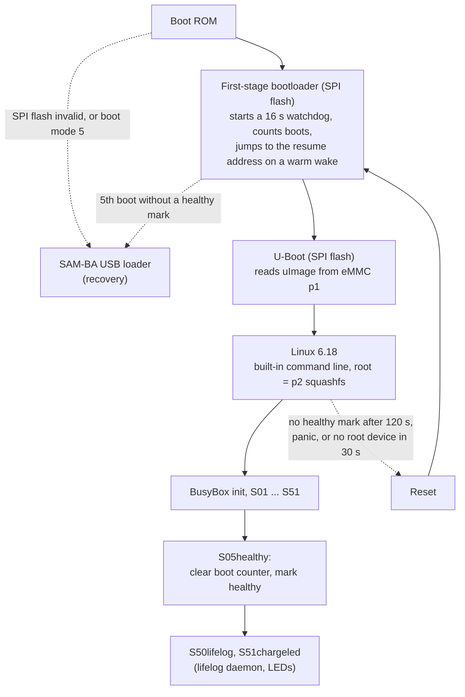
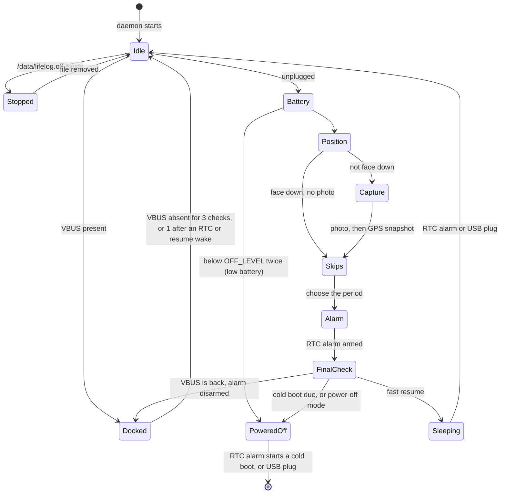
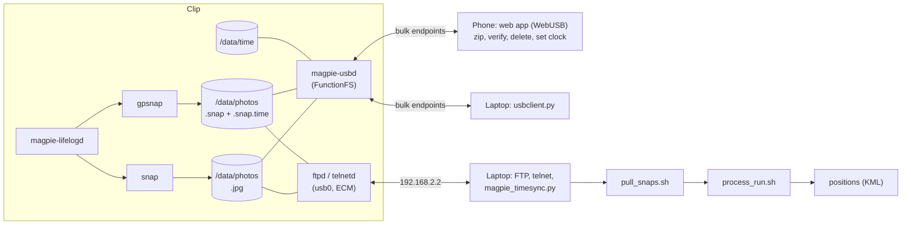

# magpie design overview

How the firmware is put together, for someone who wants to understand it or change it. For installing and using it,
see the [README](../README.md). Companion documents: [PHONE_USB.md](PHONE_USB.md) (the phone interface protocol) and
[GPS_PROCESSING.md](GPS_PROCESSING.md) (turning GPS snapshots into positions).

Contents:

1. [Goals and constraints](#1-goals-and-constraints)
2. [Hardware used](#2-hardware-used)
3. [Boot chain and safety net](#3-boot-chain-and-safety-net)
4. [Init scripts](#4-init-scripts)
5. [The lifelog cycle](#5-the-lifelog-cycle)
6. [Fast-resume sleep and the kernel patches](#6-fast-resume-sleep-and-the-kernel-patches)
7. [Camera](#7-camera)
8. [GPS capture](#8-gps-capture)
9. [Time keeping](#9-time-keeping)
10. [USB gadget](#10-usb-gadget)
11. [Data layout on /data](#11-data-layout-on-data)
12. [Host side](#12-host-side)
13. [Restore path](#13-restore-path)

## 1. Goals and constraints

- Keep a 2013 camera useful: periodic photos, a position for each, files that can be read without the vendor's
  software.
- Run a current mainline Linux (6.18, a long-term series) with a small Buildroot userland (musl, BusyBox), not a
  port of the original system.
- Do not write the SPI flash. The first-stage bootloader and U-Boot that came with the Clip stay as they are, so
  every other part can be replaced over USB.
- Everything that can go wrong in the boot ends in a reset, and repeated failure ends in the boot ROM's USB loader.
- The Clip has 32 MB of RAM and a 125 mAh battery. Code is small, and almost everything is a shell script or a small C
  program. The kernel image must stay under 2 MiB, because the bootloader reads exactly that much.

## 2. Hardware used

| Block | Part | How magpie uses it |
|---|---|---|
| SoC | Microchip (Atmel) AT91SAM9G25, ARM926EJ-S, about 382 MHz | mainline `at91sam9g25` device tree plus a board file |
| RAM | 32 MB low-power SDRAM | all of it is used. A few areas are reserved (below) |
| Boot flash | 512 KB SPI NOR | first-stage bootloader and U-Boot of the original firmware, never written |
| Main storage | 8 GB eMMC on the MCI controller | p1 kernel, p2 root filesystem, p3 data (below) |
| Camera | OmniVision OV5640 on the ISI parallel interface | stills as JPEG from the sensor's own encoder, see section 7 |
| GPS | CellGuide ACLYS on SPI1 | raw 1-bit samples, see section 8 |
| Accelerometer | LIS3DH, I2C address 0x18 | orientation (face down), optional motion wake |
| Magnetometer | AK8963, I2C address 0x0c | driver (`ak8975`) is loaded; no magpie program uses it |
| LEDs | four LEDs on PWM0 channels 0 to 3 | `/sys/class/leds/magpie:d1` to `d4`, active low |
| Battery | ADC channel 5 behind a divider that must be switched on | `magpie-battery` raw reading, full is about 249 |
| Charger status | GPIO PD15 (active low) | `magpie-charge` |
| USB | UDPHS device port (high speed) | the gadget, section 10 |
| VBUS sense | GPIO PC31 | read by the daemons, because the USB device driver does not own the pin |
| RTC and RTT | on-chip, backup power domain | wake alarm, sub-second time stamps, section 9 |
| Watchdog | on-chip | enabled by the first-stage bootloader, fed by userspace |

Both I2C buses (sensors, and the camera's control bus) are bit-banged with `i2c-gpio`.

### eMMC layout

| Partition | Start | Content |
|---|---|---|
| p1 | sector 16 | kernel: legacy uImage with the device tree appended, at most 2 MiB |
| p2 | sector 8192, 28 MiB | root filesystem: read-only squashfs (xz), about 2.6 MB used |
| p3 | rest (about 7.3 GB) | ext4, mounted at `/data` (photos, GPS captures, logs, settings) |

`flash_ums.sh` writes p1 and p2 only. p3 keeps whatever it held.

### RAM map

| Area | Purpose |
|---|---|
| first page of RAM | reserved: the first-stage bootloader's SDRAM setup writes into it on every boot, including a warm wake |
| ramoops at the 16 MB mark, 512 KiB | kernel console and oops log that survives a reset (not a power loss) |
| CMA, 12 MiB | contiguous buffers for the camera (about 2 MiB per full-size JPEG frame) |

## 3. Boot chain and safety net

### Bootloaders

The Clip's own first-stage bootloader and U-Boot are used unchanged. U-Boot has no device-tree support, so the
kernel is a uImage with the device tree appended to the zImage. The kernel ignores the arguments U-Boot passes: the
command line is built in (`console=ttyS0,115200 root=/dev/mmcblk0p2 rootfstype=squashfs ro rootwait=30 panic=10
oops=panic`).

### Safety net

Three mechanisms make sure a broken image cannot leave the Clip in a state that needs hardware access:

| Mechanism | What it does |
|---|---|
| Watchdog | The first-stage bootloader turns on a hardware watchdog (about 16 s). The kernel driver feeds it until userspace opens `/dev/watchdog`; then `S30watchdog` pings it every 5 s. If userspace stops, the board resets. |
| Boot counter | The first-stage bootloader increments a counter in a battery-backed register (GPBR2) on every boot. Above 3, it sets the boot ROM to start its USB loader (SAM-BA) instead of booting. Userspace clears the counter once the system is healthy. |
| Health marker | Kernel patch 0002: if userspace has not written the healthy value to GPBR1 within 120 s of the end of kernel start-up, the kernel restarts the board. `rootwait=30` and `panic=10` turn a missing root device and a kernel panic into resets too. |

So any hang ends in a reset within about 2.5 minutes, and a run of failed boots ends in SAM-BA, where the restore
path (section 13) takes over.

The boot progress is also written to GPBR1 as a marker, which survives a reset and can be read afterwards from the
SAM-BA monitor or `devmem`:

| GPBR1 | Meaning |
|---|---|
| `0x4D500001` | kernel running |
| `0x4D500002` | built-in drivers done |
| `0x4D500010` | init scripts started (`S01bootmark`) |
| `0x4D500020` | healthy (`S05healthy`, or a lifelog cycle) |
| `0x4D5000DD` | health deadline missed, restarted |
| `0x4D5000FF` | kernel panic |

Logs: every init step writes a line to `/dev/kmsg`. `S40data` saves the boot's `dmesg` and the previous boot's
ramoops console to `/data/logs/boot-N/` (the last 10 are kept).

## 4. Init scripts

BusyBox init runs `/etc/inittab` (Buildroot's, with progress lines added), which mounts `/proc`, runs `mount -a` and
then `/etc/init.d/rcS`, which runs the `S??*` scripts in order. The order is chosen so that the Clip becomes
reachable first and optional parts cannot delay the healthy marker: the slow or fragile steps (camera, GPS, data
mount) run in a background subshell, after `S05healthy`, and always exit 0.

| Script | What it does |
|---|---|
| `S01bootmark` | logs, writes GPBR1 = `0x4D500010` |
| `S02mounts` | tmpfs for `/tmp` and `/run`, pstore, configfs |
| `S03usbnet` | builds the USB gadget in configfs (ECM only), binds it to the UDC, sets `usb0` to 192.168.2.2/24 |
| `S04services` | `telnetd -l /bin/sh` (port 23, no login) and `ftpd -w /` under `tcpsvd` (port 21) |
| `S05healthy` | if `usb0` is up and `telnetd` runs: clear the boot counter, write the healthy marker |
| `S10mdev`, `S11modules` | Buildroot's: device nodes, module loading from a list |
| `S12peripherals` | `modprobe` of `pwm-atmel`, `leds-pwm`, `at91_adc`, `i2c-gpio`, `st_accel_i2c`, `ak8975`. Failures are logged and ignored |
| `S13camera` | background: loads `atmel-isi` and `ov5640`, waits up to 10 s for `/dev/video0` |
| `S14gps` | background: loads `spi-atmel` and `spidev`, binds `spidev` to the GPS device by `driver_override`, then drives RESET and the LNA pin high with `gpsnap --pins-only -a 1` |
| `S30watchdog` | a shell loop writes to `/dev/watchdog` every 5 s |
| `S40data` | background: mounts p3 on `/data` (ext4, `errors=remount-ro`), saves boot logs |
| `S41usbd` | adds the phone interface to the USB gadget and starts `magpie-usbd` (section 10) |
| `S50lifelog` | starts `magpie-lifelogd` in the background |
| `S51chargeled` | starts `magpie-chargeledd` in the background |

There is no getty and no login. `post-build.sh` removes the BusyBox scripts that magpie does not use (a second
`telnetd`, syslog, cron, httpd, seedrng, `S40network`).

## 5. The lifelog cycle

Two shell daemons own the behaviour of the Clip when it is worn and when it is docked.

| Daemon | Job |
|---|---|
| `magpie-lifelogd` | photo, GPS snapshot, logging, skip rules, next wake, sleep. Does nothing while VBUS is present |
| `magpie-chargeledd` | LEDs while docked: charge level, charging blink, full |

Both read VBUS (GPIO PC31, a read of the PIO status register with `devmem`) once a second. An unreadable value
counts as "docked", so a failed read never causes a power-off. All tunables and the config file loader are in
`/usr/lib/magpie-lifelog.sh`; helpers are `magpie-battery`, `magpie-charge`, `magpie-led`, `magpie-accel`, `snap`,
`gpsnap`. The scripts are POSIX sh and run on BusyBox ash; the host tests run them against stubs under dash and
BusyBox sh.

### One cycle

1. **Battery.** Read the raw battery value. If it is below `OFF_LEVEL` (205), read it again after 1 s. If still low:
   log, disarm the RTC alarm, put the accelerometer in power-down, write the CSV line (`lowbat`) and power off. Only
   USB wakes it. Between `OFF_LEVEL` and `WARN_LEVEL` (207) only a warning is logged.
2. **Position.** `magpie-accel` samples the LIS3DH. The camera is face down when the chosen axis (default Z) times
   `FACEDOWN_SIGN` is at least `FACEDOWN_THRESHOLD` (800 mg) and the other two axes are each under
   `FACEDOWN_OTHER_MAX` (350 mg).
3. **Capture**, unless face down and only if `/data` is mounted. Wait up to `WAIT_TIMEOUT` (15 s) for `/dev/video0`
   and the SPI node, then `snap -o /data/photos/<stamp>.jpg`, then `gpsnap -a 1 -o /data/photos/<stamp>.snap`. Both run
   under `timeout` (30 s). One 100 ms LED blink for a good photo: LED 1 plus more LEDs for the battery level. A photo
   smaller than `DARK_JPEG_BYTES` (60000 bytes) counts as dark. The photo is kept anyway. A failed photo is logged;
   two in a row force the next sleep to be a cold boot.
4. **Skip rules** (streak counters in `/data/lifelog/state`, compared before they are incremented):

   | Condition | Next period |
   |---|---|
   | face down, streak at most 10 | 120 s |
   | face down, streak above 10 | 240 s |
   | dark, streak above 2 | 120 s |
   | dark, streak above 10 | 480 s |
   | otherwise | `INTERVAL` (30 s) |

   The period is never shorter than `INTERVAL`. A face-down cycle resets the dark streak. A failed photo leaves it alone.
5. **Alarm.** The RTC alarm is set relative to the wake, so the interval is wake to wake:
   `alarm = max(MIN_ALARM, period - time since wake - preamble)`. After a cold boot the preamble is
   `BOOT_PREAMBLE` (5 s, the time the bootloaders take); after a fast resume it is 0. The alarm is written to
   `/sys/class/rtc/rtc0/wakealarm` and read back, up to three times. If it cannot be armed the daemon does not power
   off: it logs `noalarm`, waits `NOALARM_RETRY` seconds and starts another cycle.
6. **Last checks and log.** Apply the accelerometer wake mode (`ACCEL_WAKE`, default none). Check VBUS once more: if
   it is back, disarm the alarm and stay docked. Write the CSV line (`/data/lifelog/log.csv`).
7. **Sleep or power off** (below).

### Wake source and sleep

Every wake is either a cold boot (after a power-off) or a fast resume (the kernel continues where it stopped). The
daemon records the cause in the CSV: `RTC`, `unknown` (the WKUP0 pin: USB plug-in, or the accelerometer if its wake
is on) or `none`. On an RTC or resume wake the VBUS debounce is skipped, because the alarm just fired.

The sleep decision (`want_resume`):

| Condition | Result |
|---|---|
| `SLEEP_MODE=poweroff` | power off, RTC alarm wakes a cold boot |
| 3 failed resumes since the last docking (`RESUME_MAX_FAIL`) | power off from now on, until USB is plugged in |
| two photos failed in a row | one cold boot |
| every `COLD_EVERY`th (70) sleep | cold boot, as insurance against slow drift or leaks |
| otherwise | fast-resume sleep |

For a fast-resume sleep the daemon runs `sync`, clears GPBR3, unbinds the USB gadget and writes `mem` to
`/sys/power/state`. The call returns after the wake, in the same boot, with the daemon still running. It then reads
the wake source from the kernel line `at91-backup: resumed, SHDW_SR=...` (bit 17 is the RTC) and rebinds the gadget
if VBUS is present. The counters for sleeps and failures live in `/data/lifelog/resume`.

**Failure detection.** The kernel writes progress markers `0x4D5057xx` to GPBR3 during a sleep. If the daemon finds
one after a *cold* boot, a fast resume was started and failed (the watchdog reset the board). It logs that, clears
the marker and counts the failure. A power-off also clears a marker that a finished resume left.

**Boot counter.** Every cold-boot cycle is a boot, so the daemon also clears the boot counter and sets the healthy
marker at the start of each cycle, in case `S05healthy` did not (it needs `usb0` up).

**Docked.** While VBUS is present the daemon idles, and rebinds the USB gadget if a sleep left it unbound. A docking
resets the failed-resume count.

### Stopping it

Plug in USB; or `touch /data/lifelog.off` while docked (the Clip then stays on when unplugged); or
`/etc/init.d/S50lifelog stop` for the running session.

### Charge LEDs

`magpie-chargeledd` is the only thing that writes the LEDs while docked. On the transition to unplugged it turns all
four off once and then writes nothing (the lifelog daemon owns the LEDs then). Docked, it reads `magpie-charge` every
10 s and `magpie-battery` every 5 s:

- not charging: all four on, the top one off for a second in every four;
- charging: LEDs 1 to *level* on, the top one blinking 1 s on, 1 s off. Level is 1 to 4 from the raw reading with
  hysteresis (down to 1 below 217, up to 2 above 220, 3 above 225, 4 above 235);
- the display is redrawn in full once a minute, so a stray write cannot leave a wrong picture.

### Log format

`/data/lifelog/log.csv`, one line per cycle (rotated at `LOG_MAX`):

`date,wake,up_start_s,battery,x_raw,y_raw,z_raw,x_mg,y_mg,z_mg,photo,photo_bytes,photo_ok,gps_ok,facedown,dark,period_s,alarm_s,up_end_s,end`

`end` is one of `sleep`, `poweroff`, `lowbat`, `docked`, `noalarm`. `daemon.log` has the text log, which is also in the
kernel log (`dmesg | grep magpie-`).

## 6. Fast-resume sleep and the kernel patches

The goal is to sleep between photos like the original firmware did: the SoC core is powered off and the SDRAM keeps
its content in self-refresh, so a wake continues in the running kernel in well under a second. A cold boot
per photo takes on the order of ten seconds.

How it works with the unchanged bootloader: before the sleep, the kernel stores the address of a resume entry in
battery-backed registers (GPBR1) together with a magic value (GPBR0). The first-stage bootloader checks those on
every boot, and when they are set it jumps to that address instead of loading U-Boot. The entry restores the CPU
state and continues in the kernel's normal resume path.

### Kernel patches (`br2-external/patches/linux/`)

Applied on top of Linux 6.18 by Buildroot.

| Patch | Purpose |
|---|---|
| 0001 `soc: atmel: add magpie boot progress markers` | writes the boot markers to GPBR1 (running, drivers done, panic) |
| 0002 `magpie-bootmark: restart if not healthy` | the 120 s health deadline (`magpie_bootmark.health_deadline`, 0 = off) |
| 0003 `ov5640, atmel-isi: JPEG pass-through` | stills as sensor-encoded JPEG, see section 7 |
| 0004 `atmel-isi: disable the ISI before stopping the sensor` | the ISI only finishes a disable while the sensor still supplies a pixel clock, so the ISI is disabled first |
| 0005 `ARM: at91: pm: stock-style backup sleep for sam9x5` | the sleep itself (below) |
| 0006 `at91_adc: restore the mode register on resume` | the core power cut resets the ADC; the driver restores its mode register after a wake |
| 0007 `atmel-isi: restore CFG1 on runtime resume` | the core power cut resets the ISI; the driver restores its bus configuration after a wake |
| 0008 `ov5640: power down for system sleep` | the sensor's power and reset pins are reset by the power cut, so the sensor is powered down before the sleep and set up from scratch after it |
| 0009 `atmel-isi: never leave a DMA channel armed` | stop both DMA channels at stream start and stop and on the error path, keep buffers until the DMA is stopped, so a late frame cannot land in freed memory |

Patch 0005 adds the "mem" sleep (`CONFIG_AT91_SAM9_BACKUP_SLEEP`):

- it saves the PMC, AIC and PIO registers (the power cut wipes them) and restores them in that order right after the
  resume, before the PM core resumes any device;
- it puts the SDRAM into self-refresh and cuts the core power through the shutdown controller, with the routine
  running from on-chip SRAM;
- it saves GPBR1 (also the boot marker), sets GPBR0 and GPBR1 for the bootstrap's warm start, clears the bootstrap's boot
  counter (GPBR2) in the resume entry and afterwards, and uses GPBR3 for progress markers (`0x4D505700` sleeping,
  `...02` back in C code, `...03` hardware restored). A hang after the cut leaves a marker that the lifelog daemon
  finds after the watchdog reset;
- wake sources are the RTC alarm and the WKUP0 pin;
- it logs `at91-backup: resumed, SHDW_SR=0x...` which the daemon reads for the wake source.

Drivers that lose state in the power cut restore it themselves (0006 to 0009). The first DMA-sized SPI read after a
wake is handled in `gpsnap` (section 8).

### Other kernel choices

The kernel config starts from `allnoconfig` (`board/magpie/linux/allconfig.txt`) and lists only what is needed.
Built in: MMC, squashfs, ext4, USB device controller with configfs (ECM, mass storage), the watchdog, RTC, pstore,
power management. Drivers for camera, SPI, I2C, PWM, ADC and sensors are modules, loaded by the init scripts. No
crypto, no IPv6, no USB host. `KALLSYMS` is off to save about 190 KB, so oops addresses are decoded offline with the
build's `vmlinux`.

## 7. Camera

`/usr/bin/snap` captures one 2592x1944 JPEG through V4L2 (`atmel-isi` driver, node found by driver name).

The full-size frame does not fit in RAM uncompressed, so the sensor's own JPEG encoder is used (patch 0003). The
OV5640 is set to send 1024-byte lines, each starting with a 2-byte big-endian count of JPEG bytes that follow, at most
2048 lines (2 MiB). The ISI codec path stores the bytes unchanged. `snap` joins the payloads up to the end-of-image
marker and writes a plain `.jpg`: first to `PATH.tmp`, flushed, then renamed. It discards the first 10 frames so
exposure can settle, locks its memory, takes its capture buffers (about 2 MiB each) from the CMA area, and stops
streaming on every exit path.
Exit codes: 0 ok, 1 usage, 2 device error, 3 timeout, 4 write error.

## 8. GPS capture

The GPS chip does no navigation. It delivers raw 1-bit I/Q samples at about 1.024 Msps in 4096-byte pages of 16 ms. A
`gpsnap` capture is 32 pages (512 ms, 131072 bytes). Positions are computed later on a computer
([GPS_PROCESSING.md](GPS_PROCESSING.md)).

**Wiring.** SPI1 (mode 2, 18.3 MHz) with chip select on PA0, DATA READY on PA1 (active low, one falling edge per page),
RESET on PA6, LNA enable on PA28. The device tree declares the chip as `cellguide,aclys`; there is no kernel driver,
so `S14gps` binds the generic `spidev` driver to it through `driver_override`, giving `/dev/spidev1.1`.

**`gpsnap`** (`br2-external/package/gpsnap`, a C program using spidev and the GPIO character device v2 uAPI):

1. find the PIOA GPIO chip by label, request RESET and LNA as outputs and DATA READY as input with falling-edge
   events;
2. reset pulse, open SPI, reset pulse again, read the version register (expected `0x01001A00`) and power the chip up;
3. write the configuration registers, then the RF section, which is a small serial port driven through one register;
4. write the page count and the capture start registers, then read the pages. For each page it waits for the DATA
   READY edge (timeout 100 ms) and reads 4096 bytes in one `read()` so chip select stays low for the whole page;
5. power the chip down, then write the file. It writes `PATH` and `PATH.time`.

To keep the CPU out of the way the program locks its memory, allocates and touches the whole buffer before the
capture, does no file I/O until the capture is over, and uses `SCHED_FIFO` when allowed. Exit codes: 0 ok, 1 usage,
2 device error, 3 DATA READY timeout, 4 write error, 5 test-pattern mismatch (`-e`). `-t` makes the chip output a
counter pattern instead of samples; `-t -e` checks the transport.

**The `.time` sidecar** is a text file:

| Key | Meaning |
|---|---|
| `first_page_utc` | UTC time of the DATA READY edge that ended page 0 (kernel edge time stamp, converted from the monotonic to the realtime clock). Sample 0 is about 16 ms earlier |
| `source` | `edge` (kernel time stamp) or `level` (the line was already low, read time) |
| `pages` | number of pages |
| `rtt`, `rtt_pres`, `rtt_after_edge_us` | the Real-time Timer count read right after the edge, its prescaler (slow-clock cycles per count) and the delay between edge and read |

The file name's time is taken before the chip is configured and can be about half a second early. Use `.time`.

### Page reads

- **Priming read.** During the RESET pulse, while the chip is held off the bus, `gpsnap` does one 4096-byte SPI read
  and discards it. The first DMA-sized SPI read after a hardware reset of the SoC (every wake from sleep and every
  boot) returns one stale 32-bit word; this read absorbs it before the capture starts.
- **Edge-only page waits.** A page counts as ready only on a falling DATA READY edge time-stamped at least 12 ms after
  the previous page (or the capture start); pages arrive every 16 ms. The line level is not used, so a lost or extra
  edge shows up as a timeout (exit 3) rather than as a shifted page. Register reads use the line level.

## 9. Time keeping

| Clock | Resolution | Survives | Used for |
|---|---|---|---|
| System clock | 1 us | nothing: restored from the RTC at each cold boot and after each fast resume | file names, `.time` `first_page_utc`, logs |
| RTC | 1 s | power-off, fast-resume sleep (backup power domain) | wake alarms, restoring the system clock |
| RTT (real-time timer) | 0.9765625 ms | power-off, fast-resume sleep, cold boots | fine capture time |

The RTC keeps whole seconds only, so each time the system clock is restored from it, the sub-second part is lost. The RTT is a 32-bit counter in the backup domain, clocked from the 32.768 kHz crystal with
a prescaler of 32 (one count is 0.9765625 ms; it wraps after about 48 days). It keeps running through sleeps. `gpsnap`
records its count in each `.time` file, so the UTC time of a capture can be recomputed from the count and the stored
epoch:

`UTC = epoch_utc + rtt * rtt_pres / 32768 - rtt_after_edge_us` (the crystal's frequency error, tens of ppm, adds
to the uncertainty).

`/data/time/` holds the RTT epoch and calibrations.

| File | Content |
|---|---|
| `rtt_epoch` | one line per restart: `epoch_utc=<s> pres=32 set=<ISO time> fit_roundtrip_ms=...` |
| `rtt_cal` | one line per calibration: `cal=<ISO time> epoch_fit=<s> diff_ms=<ms> fit_roundtrip_ms=<ms>` (the difference to the stored epoch is crystal drift) |

### Setting the clock

There is no network time on the Clip. Two ways to set it while docked:

- **`tools/magpie_timesync.py`** (laptop, over telnet). It runs `date -u -s` on the Clip so that it takes effect on a
  whole second of the host's clock (the send time is corrected by the measured one-way latency, in two passes), then
  `hwclock -w -u` for the RTC. If the RTT is not running at the magpie prescaler (first use, or after a total power
  loss) it restarts it with a prescaler of 32 and stores its epoch in `rtt_epoch`. Otherwise it leaves it running, so
  earlier captures keep their timebase, and appends a calibration line to `rtt_cal`. It then times the next second
  rollover to report the remaining offset. `--check` only measures, `--wait` retries the connection for up to 120 s.
- **Phone `SETTIME`** (command 0x0007 of the USB protocol, [PHONE_USB.md](PHONE_USB.md)). The page measures the round
  trip with a few `TIME` requests and sends the time at which the request will be processed. `magpie-usbd` sets
  the system clock, writes the RTC with `hwclock -w -u`, and, if the RTT runs at the magpie prescaler and an epoch file
  exists, appends a calibration line. It never restarts or rewrites the RTT.

The position solver currently uses `first_page_utc` as the capture time. The RTT count is stored so that the
capture time can be refined later.

## 10. USB gadget

The Clip is a USB device through the SoC's UDPHS controller (high speed). The gadget is built in configfs at
`/sys/kernel/config/usb_gadget/magpie`: vendor id `0525`, product id `a4a1` (the same ids the original firmware's
Ethernet mode used, so host setups for it keep working), product string "Magpie camera", one configuration `c.1`.

| Step | Script | Result |
|---|---|---|
| 1 | `S03usbnet` | gadget with CDC-ECM function `ecm.usb0`. `usb0` is 192.168.2.2/24. Telnet and FTP (`S04services`) run on it |
| 2 | `S41usbd` | adds FunctionFS function `ffs.magpie` (vendor-specific interface, one bulk OUT and one bulk IN endpoint) and `magpie-usbd` |

### Why `S41usbd` rebuilds the order

`S41usbd` loads `usb_f_fs`, creates `ffs.magpie`, mounts it on `/dev/ffs-magpie` and starts `magpie-usbd`. The daemon
writes its USB descriptors; when `ep1` appears the script unbinds the UDC, links the function into `c.1`, and rebinds.
**`ffs.magpie` is linked before `ecm.usb0`** (the script removes the ECM link and puts it back after). The UDPHS
allocates endpoint FIFO memory in endpoint order, and the host re-enables ECM's endpoints whenever it switches the
ECM data interface on. With FunctionFS at the lower endpoint numbers, that re-allocation cannot overlap FunctionFS's
buffers.

Any failure in `S41usbd` leaves, or restores, the ECM-only gadget, so the laptop link never depends on the daemon.

### `magpie-usbd`

`br2-external/package/magpie-usbd` is a C program that serves the files in `/data/photos` over the FunctionFS bulk
endpoints with a simple request/response protocol (16-byte header, JSON requests, one request at a time). The
protocol is in [PHONE_USB.md](PHONE_USB.md). Design points:

- two threads: one owns `ep0` (FunctionFS events and stalls), because endpoint files cannot be polled; the other serves
  requests with blocking reads and writes on the data endpoints. No timers or signals interrupt a transfer;
- reads and writes go in 16 KiB pieces (multiples of the 512-byte packet), because the kernel allocates one contiguous
  buffer per call on a small system;
- the host going away (unplug, or the lifelog daemon unbinding the gadget for a sleep) only ends the current request.
  The daemon waits for the function to be enabled again;
- only names matching `YYYYMMDD-HHMMSS.(jpg|snap|snap.time)` inside `/data/photos` are served or deleted. DELETE
  succeeds only if the file's current SHA-256 matches the one sent;
- it runs as root and has no authentication, like telnet and FTP on the same cable.

`magpie-usbmode` exists to swap the network function for a USB mass-storage export of p3 (`ether` or `storage`). It
is not part of normal use.

### Data flow

## 11. Data layout on /data

| Path | Content |
|---|---|
| `photos/YYYYMMDD-HHMMSS.jpg` | photo, named by the Clip's UTC clock at the start of the cycle |
| `photos/YYYYMMDD-HHMMSS.snap` | GPS snapshot, same stem, 131072 bytes |
| `photos/YYYYMMDD-HHMMSS.snap.time` | its time sidecar |
| `lifelog.conf` | optional settings (`etc/lifelog.conf.example` lists every key) |
| `lifelog.off` | stop switch |
| `lifelog/log.csv`, `log.csv.1` | per-cycle log |
| `lifelog/daemon.log`, `daemon.log.1` | text log |
| `lifelog/state` | `fd_count=` and `dark_count=` |
| `lifelog/resume` | `resume_fail=` and `sleep_count=` |
| `time/rtt_epoch`, `time/rtt_cal` | RTT epoch and calibration lines |
| `logs/boot-N/` | `info.txt`, `dmesg.txt`, `pstore/` of the previous boot; the last 10 boots |

The root filesystem is read-only; `/tmp` and `/run` are tmpfs. Anything that must survive a reboot is on `/data`.
The state files are written to a temporary name and renamed.

## 12. Host side

| Tool | Purpose |
|---|---|
| `scripts/br.sh`, `scripts/xrun.sh` | build in Docker, run a command with the cross toolchain |
| `tools/restore.py`, `tools/samba.py`, `tools/flash_ums.sh` | flashing and recovery (section 13) |
| `tools/magpie_sh.py`, `magpie_ftp_get.py`, `magpie_ftp_put.py`, `magpie_dump.py` | telnet commands, FTP get and put, verified block device dump |
| `tools/magpie_timesync.py` | clock and RTT set from the host (section 9) |
| `tools/phone/usbclient.py` | the laptop client for the USB data interface; also the reference for the browser client |
| `tools/bridge.sh`, `tools/ecm_tap_bridge.py` | a userspace USB-Ethernet bridge for hosts whose driver does not bring the link up |
| `tools/serial_log.py` | capture the debug serial console |
| `tools/gps/` | the GPS pipeline, see below |
| `web/` | the phone web app |

### GPS pipeline

`pull_snaps.sh` copies captures over FTP. `process_run.sh` runs the chain: fetch broadcast ephemeris for the day
(`nav.py`), blind search for satellites in every capture (`snapfix.py`, which calls `drift_search.py`), a run-level
solve for the clock offset (`joint.py`), an aided search that looks for weak satellites only where they must be
(`aided.py`), and a second run-level solve, with KML output (`kml.py`). The signal model, each step and the measured
accuracy (median about 30 m in open-sky tests) are in [GPS_PROCESSING.md](GPS_PROCESSING.md).

### Phone web app

`web/` is a static page (no server component): `webusb.js` opens the vendor-specific USB interface, `proto.js` packs
and parses the frames, `zip.js` and `zipread.js` write and read zip files, `app.js` is the interface. It is deployed
to GitHub Pages and works offline through a service worker (`sw.js`). Downloaded files are checked against the
Clip's SHA-256; the page builds zip files (a new one after about 256 MiB, each with a `SHA256SUMS` file); deletion is
only offered for files that were found intact in a zip that the user picked again after saving. The wire protocol and
its edge cases are in [PHONE_USB.md](PHONE_USB.md).

## 13. Restore path

The restore path does not use any code on the eMMC or in the SPI flash, so it works whatever is installed.

1. Get to the boot ROM's SAM-BA loader (USB `03eb:6124`): from a running system with the original firmware's
   `flashmode`, from a failed-boot streak, or by resetting the board through its test pads.
2. `tools/restore.py uboot` loads a small SDRAM initialisation program (`restore/sdram_init.S`) into on-chip SRAM,
   runs it, loads a modern U-Boot (2026.07, `magpie_restore_defconfig`) into SDRAM at `0x21100000` and starts it. Before
   starting it, the tool sets the boot mode back to normal, so the board does not return to SAM-BA at the next reset.
3. That U-Boot does one thing: `ums 0 mmc 0; reset`. It exports the eMMC to the host as a USB disk (`0525:a4a5`,
   "UMS disk"). It has no environment storage, no SPI flash driver and no network, so it cannot damage the
   bootloaders.
4. `tools/flash_ums.sh` writes and verifies the images on that disk (or the saved original 32 MiB with
   `--restore-stock`).
5. Ejecting the drive ends `ums`, and U-Boot resets into a normal boot.

U-Boot patches (`br2-external/patches/uboot/`): 0001 honour the bus width in the MCI driver; 0002 detach the UDC before
enabling it; 0003 `f_mass_storage` ejects only on a load/eject request without start, as Linux does; 0004 it keeps its
idle count across commands, so a normal eject ends `ums` even while the host polls the drive.

The case that USB cannot recover is a damaged first-stage bootloader that still passes the boot ROM's check, which is
why magpie never writes the SPI flash.
