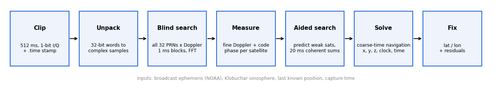
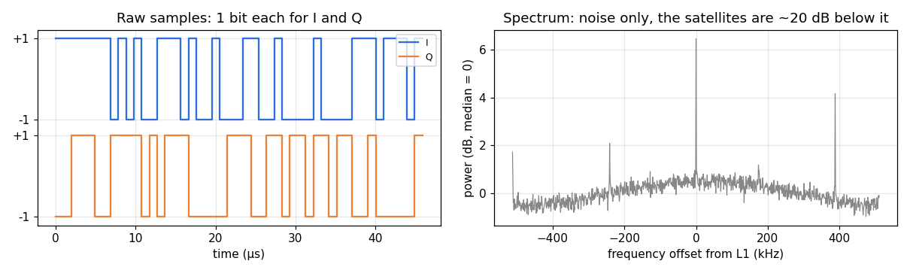
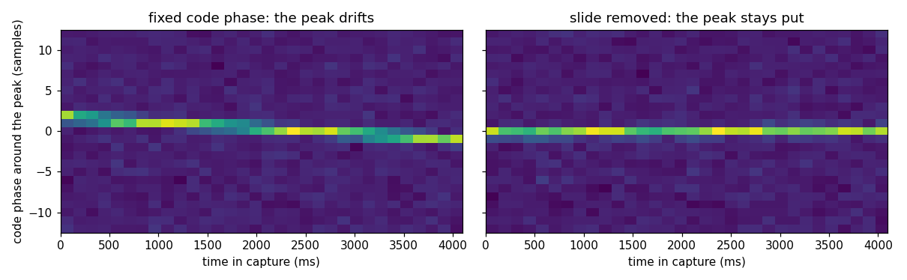
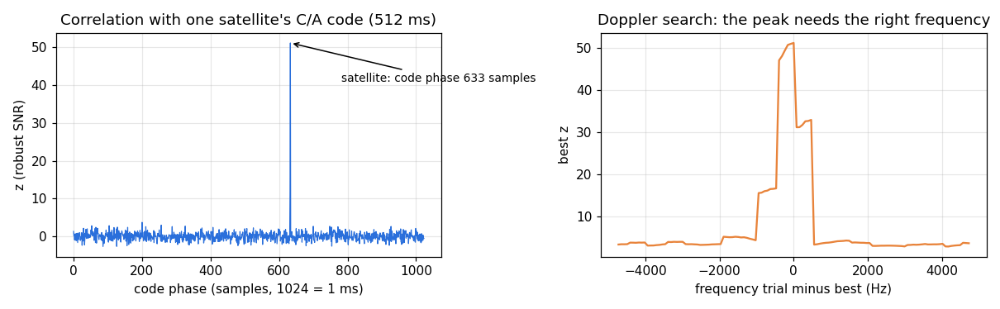
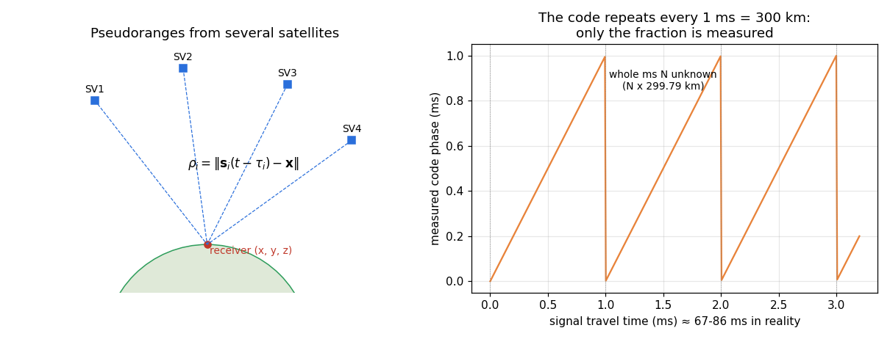
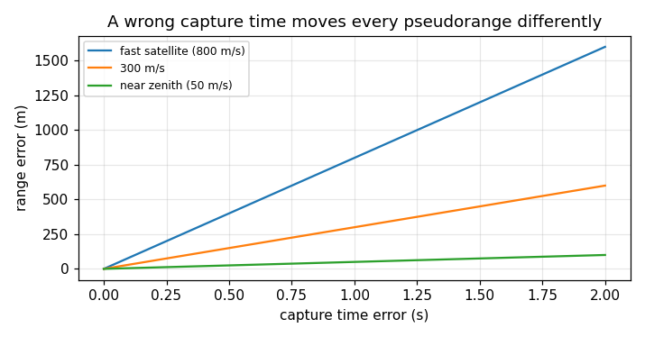
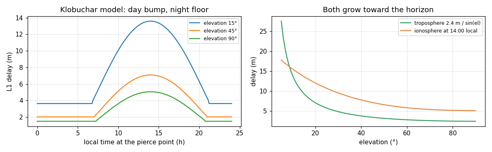
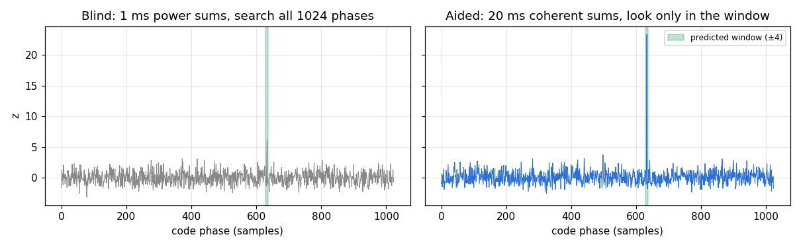
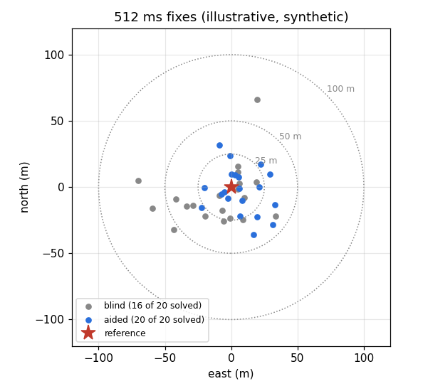

# GPS post-processing: from 512 ms of raw bits to a position

The Clip does not compute positions. Every photo comes with a **snapshot**: half a second of raw, 1-bit radio
samples from the GPS front end, plus a time stamp. Everything else (finding satellites, measuring them, solving
for a position) happens later on a computer, in `tools/gps/`. This document walks through that processing and
the maths behind each step.

| step | code |
|---|---|
| unpack, blind search, measurements | `drift_search.py`, `snapfix.py` (`measure`) |
| ephemeris, ionosphere | `nav.py` |
| satellite geometry, position solve | `snapfix.py` (`geom`, `code_fix`) |
| aided search | `aided.py` |
| run-level clock offset, KML | `joint.py`, `kml.py` |
| whole pipeline for one run | `process_run.sh` (`pull_snaps.sh` copies the captures off the Clip) |

---

## 1. What the Clip records

The GPS chip mixes the L1 band ($f_{L1} = 1575.42$ MHz) down to (nominally) 0 Hz and samples it as complex
baseband, **one bit for I and one bit for Q**, at

$$ f_s = 1.024\ \text{Msps}. $$

The chip delivers 16 ms pages (16 384 samples, 4 096 bytes) and `gpsnap` stores 32 of them: 512 ms, 128 KiB.
Bits are packed into 32-bit words (byte-swapped, least significant bit first, I on even bits, Q on odd bits), so
unpacking gives a complex sequence

$$ z[n] = (2 b_{2n} - 1) + j\,(2 b_{2n+1} - 1), \qquad z[n] \in \{\pm1 \pm j\}. $$

A side file `.time` records when page 0 completed: the DATA READY interrupt's kernel time stamp converted to UTC,
and the count of the Real-time Timer (RTT), a free-running counter that keeps going through sleep and power-off.
Right after the Clip's clock was synchronised the kernel time is good to a few tens of milliseconds. After a
fast-resume wake, however, Linux restores its clock from the whole-second RTC, so a lifelog capture's kernel time
can be off by up to a second; the RTT count (with the epoch and calibration kept in `/data/time/`) does not have
that problem. The solver currently uses the kernel time and leaves the residual to the capture-time unknown $t_c$
(section 6); using the RTT time instead is planned.

The spectrum is flat noise. GPS signals arrive about **20 dB below** the noise floor; they only become visible
after correlation with the right code at the right frequency.

---

## 2. The signal model

Each satellite $i$ transmits a 1023-chip pseudo-random **C/A code** $c_i$ at 1.023 Mchip/s (one period = 1 ms),
multiplied by 50 bit/s navigation data $D_i(t) = \pm 1$. After down-conversion the received signal is

$$ z(t) = \sum_i A_i\, D_i(t)\, c_i\!\left(t - \tau_i(t)\right) e^{\,j 2\pi f_i t + j\varphi_i} + \text{noise}. $$

Two things move each satellite's signal:

- the **Doppler shift** $f_{d,i}$ from its line-of-sight speed (up to about ±4 kHz), and
- the Clip's own clock error $\varepsilon$ (a few ppm), which shifts every frequency **and** stretches the sample
  clock, because one crystal drives both the mixer and the sampler.

Both are captured by one dimensionless number per satellite,

$$ \eta_i = \frac{f_{d,i}}{f_{L1}} - \varepsilon , $$

which sets the residual carrier frequency $f_i = \eta_i f_{L1}$ **and** how fast the code phase slides through the
capture:

$$ \text{code rate} = \frac{1023}{1024}\,(1 + \eta_i)\ \text{chips per sample}, \qquad
   \Delta\tau_i(t) = \eta_i\, f_s\, t\ \text{samples}. $$

At $\eta = 2$ ppm the peak moves 2 samples per second. That matters: summing many milliseconds at a fixed code
phase smears the peak.

*Left: one real satellite, correlation power in 128 ms slices of a 4 s capture at a fixed code phase; the peak walks
about 3 samples. Right: the same data with the slide removed.*

---

## 3. Blind search (acquisition)

With no prior knowledge, every PRN (1-32) and every plausible $\eta$ is tried.

**Blocks.** The capture is cut into 1 ms blocks of $N = 1024$ samples, each FFT'd once:
$X_b[k] = \mathrm{FFT}\{z_b[n]\}$. The mean of each block and the mean block (anything repeating every 1 ms,
such as on-board interference) are removed first.

**Carrier removal.** Shifting the spectrum by $m$ bins removes $m$ kHz. A second copy of the blocks,
pre-multiplied by $e^{-j2\pi \cdot 500\,\mathrm{Hz}\cdot t}$, gives 500 Hz steps, so the carrier left over is at
most 250 Hz (a loss of $\le 0.9$ dB within a 1 ms block).

**Code correlation and slide removal.** In the frequency domain, with $C_i[k]$ the FFT of the sampled code and
$\Delta\tau_b = \eta f_s t_b$ the slide at block $b$:

$$ R_b[\ell] = \mathrm{IFFT}\Big\{ X_b[k]\; C_i^*[k]\; e^{-j 2\pi k \Delta\tau_b / N} \Big\}[\ell] . $$

The phase ramp is an exact fractional delay, so every block's peak lands on the same lag $\ell$.

**Non-coherent sum and detection.** Unknown data bits and the residual carrier make the block phases random, so
powers are added:

$$ S[\ell] = \sum_b \left| R_b[\ell] \right|^2, \qquad
   z = \frac{\max_\ell S[\ell] - \operatorname{median}(S)}{1.4826\,\operatorname{MAD}(S)} . $$

$z$ is a robust signal-to-noise ratio: noise gives $z \approx 4$-6 for the best of 1024 lags; a satellite is
accepted from $z \ge 8$. The $\eta$ grid spacing is chosen so the slide error over the whole span stays below
0.4 samples ($\delta\eta = 0.4 / (f_s T)$).

*A real satellite in a 512 ms capture: a single sharp correlation peak (left) that only appears near the right
frequency (right; the plateaus are the 500 Hz carrier steps).*

---

## 4. Measurements

For each detected satellite three numbers are measured.

**Fine $\eta$.** $\pm 0.4$ ppm around the coarse value in 0.02 ppm steps over the whole capture, refined by a
parabola through the three best points.

**Code phase $\tau_i$.** The correlation is computed at 8× finer lag resolution (zero-padding the spectrum before
the inverse FFT) and the peak is refined by a parabola. $\tau_i$ is the time from sample 0 to the start of the next
code epoch: a fraction of a millisecond, with a precision of a few metres times $c$.

**Carrier Doppler.** The complex correlation at the peak, block by block, rotates at the true carrier frequency.
Squaring removes the ±1 data bits:

$$ w_b = \left( R_b[\ell^\ast]\, e^{-j 2\pi f_0 t_b} \right)^2 , \qquad f_0 = \eta f_{L1}, $$

and an FFT of $w_b$ finds the residual $f_2$; Doppler $= f_0 + f_2/2$. Because blocks are 1 ms apart and the
frequency was doubled, this is only known modulo 500 Hz; the right alias is the one that keeps 20 ms coherent sums
coherent (section 8 explains those sums).

---

## 5. Where the satellites are: broadcast ephemeris

Each satellite's orbit comes from its **broadcast ephemeris**, published daily by NOAA (`brdcDDD0.YYn.gz`,
`nav.py fetch`). For time $t$ and an ephemeris valid at $t_{oe}$ ($t_k = t - t_{oe}$):

$$
\begin{aligned}
n &= \sqrt{\mu / A^3} + \Delta n, \qquad M = M_0 + n\,t_k, \qquad M = E - e \sin E \;\;(\text{solve for } E),\\
\nu &= \operatorname{atan2}\!\left(\sqrt{1-e^2}\sin E,\ \cos E - e\right), \qquad \Phi = \nu + \omega,\\
u &= \Phi + C_{us}\sin 2\Phi + C_{uc}\cos 2\Phi, \quad r = A(1 - e\cos E) + C_{rs}\sin 2\Phi + C_{rc}\cos 2\Phi,\\
i &= i_0 + \dot i\, t_k + C_{is}\sin 2\Phi + C_{ic}\cos 2\Phi, \qquad
\Omega = \Omega_0 + (\dot\Omega - \omega_E)\, t_k - \omega_E\, t_{oe},
\end{aligned}
$$

and the Earth-fixed position is the orbital-plane point $(r\cos u,\ r\sin u)$ rotated by $i$ and $\Omega$.
The satellite clock error adds

$$ \delta t_{\mathrm{sat}} = a_{f0} + a_{f1}(t - t_{oc}) + a_{f2}(t - t_{oc})^2 + F\, e \sqrt{A} \sin E - T_{GD} , $$

with the relativistic term $F = -4.442807633 \times 10^{-10}\ \mathrm{s/\sqrt{m}}$.
The signal left the satellite $\rho/c \approx 70$ ms before it arrived, during which the Earth turned; the
satellite position is rotated by $\omega_E\,\rho/c$ about the z axis (Sagnac correction), iterated three times.

---

## 6. Solving for the position: coarse-time navigation

A normal receiver reads the time of transmission from the navigation data. A 512 ms snapshot cannot (one data
frame takes 6 s), so the code phase is only known **modulo 1 ms**, which is 299.79 km of range. The solve has to
recover the whole milliseconds and copes with an imperfect capture time.

**Measurement model.** For satellite $i$, with $N_i$ the unknown whole milliseconds:

$$ c\,\tau_i + N_i\, c\cdot 1\,\mathrm{ms} \;=\; \rho_i\!\left(\mathbf{x},\, t_0 + t_c + \tau_i\right)
   + T_i + I_i + b - c\,\delta t_{\mathrm{sat},i} , $$

with unknowns: position $\mathbf{x}$ (3), a common clock bias $b$ (the receiver's unknown time offset, in
metres), and the **capture-time error** $t_c$. $T_i$ and $I_i$ are the tropospheric and ionospheric delays
(section 7).

**Why $t_c$ is solvable.** A wrong capture time moves each satellite along its orbit, changing each pseudorange
by $\dot\rho_i\, t_c$. The satellites have different range rates (−800 to +800 m/s), so $t_c$ does not look like
a common bias and can be estimated with a fifth satellite (or with a prior when only four are seen).

**Whole milliseconds.** With a position guess $\hat{\mathbf{x}}$ within ~100 km (the last known position, or a
Doppler-only fix), the predicted ranges fix $N_i$ relative to a reference satellite:

$$ N_i = \operatorname{round}\!\left( \frac{(\hat\rho_i - c\,\delta t_i - c\,\tau_i) - (\hat\rho_r - c\,\delta t_r - c\,\tau_r)}{c \cdot 1\,\mathrm{ms}} \right) + N_r . $$

When no seed is available, a small grid of guesses and a ±1 ms search per satellite pick the set with the smallest
residual.

**Doppler-only fix** (when there is no seed): measured Dopplers fit
$f_i = -\dot{\mathbf{s}}_i \cdot \hat{\mathbf{u}}_i / \lambda + f_c$ for position and receiver frequency offset;
good to tens of km, enough to fix the milliseconds.

**Solve.** Gauss-Newton on the five unknowns with a numerical Jacobian, plus two soft constraints written as extra
rows: height near the ground (100 m of height weighs like 10 m of pseudorange; five satellites otherwise allow
false fits deep underground with a large time error) and, when known, a prior $t_c = T \pm \sigma$.

**Run-level clock offset.** All captures in a run share the Clip's clock offset. `joint.py` solves each capture
with five or more satellites on its own, takes the median $T$ of their $t_c$, then re-solves every capture with
the prior $t_c = T \pm 20$ ms. That rescues captures with only four satellites.

---

## 7. The atmosphere

**Troposphere.** A simple model: $T_i = 2.4\ \mathrm{m} / \sin(\mathrm{el}_i)$, floored at 3° elevation.

**Ionosphere (Klobuchar).** The broadcast model uses eight coefficients $\alpha_n, \beta_n$ from the ephemeris file
header (`ION ALPHA` / `ION BETA`). In semicircles, with user latitude $\phi_u$, longitude $\lambda_u$,
elevation $E$ and azimuth $A$:

$$
\begin{aligned}
\psi &= \frac{0.0137}{E + 0.11} - 0.022, \quad
\phi_i = \phi_u + \psi\cos A \;(\text{clamped to } \pm 0.416), \quad
\lambda_i = \lambda_u + \frac{\psi \sin A}{\cos \phi_i},\\
\phi_m &= \phi_i + 0.064\cos(\lambda_i - 1.617), \qquad t = 43200\,\lambda_i + t_{\mathrm{GPS}} \bmod 86400,\\
F &= 1 + 16\,(0.53 - E)^3, \quad \mathrm{AMP} = \sum_{n=0}^{3} \alpha_n \phi_m^n, \quad
\mathrm{PER} = \max\!\Big(72000,\ \sum_{n=0}^{3} \beta_n \phi_m^n\Big), \quad x = \frac{2\pi(t - 50400)}{\mathrm{PER}},\\
I &= c\,F \left[ 5\times10^{-9} + \mathrm{AMP}\left(1 - \frac{x^2}{2} + \frac{x^4}{24}\right) \right]
   \quad (|x| < 1.57;\ \text{else } c\,F\cdot 5\times 10^{-9}).
\end{aligned}
$$

Both delays are largely common to all satellites, so the clock bias $b$ absorbs most of them; what remains moves a
fix by a few metres. They matter more at midday and for low satellites.

---

## 8. Aided acquisition: finding the weak satellites

The blind search needs $z \ge 8$ because it looks at about 90 000 cells per satellite (1024 lags × ~90 frequency
steps); the best noise cell alone reaches $z \approx 6$. Once a few strong satellites are found, everything about
the others can be **predicted**, and the search shrinks to a tiny window.

**Prediction.** At the seed position and capture time, for every satellite above 5°:

$$ \hat f_i = -\frac{\dot\rho_i}{\lambda} + f_c, \qquad
   \hat\tau_i = \left(\frac{\rho_i - c\,\delta t_i + T_i + I_i}{c} + b\right) \bmod 1\,\mathrm{ms} . $$

The receiver terms $f_c$ (frequency offset) and $b$ (code bias) are the same for every satellite; they are
calibrated as **circular means** over the strong satellites (modulo 500 Hz and 1 ms), with outliers dropped. Tested
by predicting each strong satellite from the others: errors of at most 0.16 samples and 0.2 Hz.

**Coherent integration.** Knowing the frequency to a few hertz allows summing the complex correlations over a whole
navigation data bit (20 ms) before squaring. That gains signal-to-noise roughly as $\sqrt{20}$ per bit compared with
1 ms power sums. Bits start at an unknown block, so all 20 offsets $o$ are tried:

$$ P_o[\ell] = \sum_{j} \left| \sum_{b=o+20j}^{o+20j+19} R_b[\ell]\; e^{-j 2\pi \hat f\, t_b} \right|^2 , $$

over $\hat f \pm 25$ Hz in 5 Hz steps and $\hat\tau \pm 4$ samples: about 2 000 cells instead of 90 000.

*The same real satellite, artificially weakened: in the blind search (left) it barely rises above the noise and
would be missed among 90 000 cells; with 20 ms coherent sums in the predicted window (right) it stands at z ≈ 23.*

**Threshold.** The identical search is run on satellites **below the horizon**, which cannot be present. The
largest $z$ seen there over a whole run (about 5.6) plus a margin sets the detection threshold (about 6.6).

---

## 9. Results and limits

*Illustrative scatter (synthetic numbers with the statistics measured in tests, around a made-up origin).*

Measured in open-sky tests (512 ms captures, a whole run sharing one clock offset):

| | blind search | aided search |
|---|---|---|
| captures solved on their own | 16 of 20 | 20 of 20 |
| median error | ~30 m | ~30 m |
| worst error | ~70 m | ~57 m |

- **Longer captures are not better.** 1 s gives about the same accuracy as 512 ms, and 4 s is worse: the code
  phase slides by several samples and the satellite geometry changes during the capture. Longer captures only help
  weak signals.
- **Why tens of metres.** Two-level (1-bit) sampling at about 1 MHz bandwidth limits code-phase precision to a few
  metres per satellite; five to seven satellites with modest geometry, a simple troposphere and broadcast orbits
  add up to tens of metres. Stock Narrative positions were computed the same way, on a server.
- **What the capture time must be.** Within about a second for a single capture (solved as $t_c$), better than
  ~50 ms for the run-level prior to help; the Clip's clock is synchronised when docked.
- **Indoors and in pockets** the signals are typically 10-20 dB weaker than the detection limit; nothing is found.

### Possible next steps

- Coherent integration over the whole snapshot with the navigation data bits wiped off (known bits from the
  ephemeris broadcast), for another few dB on weak satellites.
- Direct position estimation: search positions directly against the correlation surfaces instead of solving from
  per-satellite measurements.
- Combining consecutive captures with the shared clock model.
